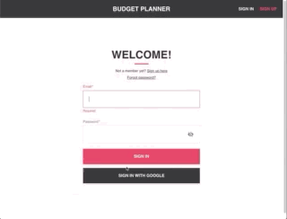

# Budget Planner

<h1 align="center">
    
</h1>

<h3 align="center">
  Budget Planner - Legacy Codebase Analysis & Modernization
</h3>

<p align="center">A comprehensive analysis and modernization guide for a React budget planning application.</p>

<p align="center">
  <a href="https://react-budget-planner.web.app/">Live Demo</a>&nbsp;&nbsp;&nbsp;|&nbsp;&nbsp;&nbsp;
  <a href="https://simongt.net/">Portfolio</a>&nbsp;&nbsp;&nbsp;|&nbsp;&nbsp;&nbsp;
  <a href="https://github.com/simongt">GitHub</a>
</p>

<p align="center">
    
</p>

## 📋 Project Overview

This is a **budget planning web application** built in 2020 that helps users calculate potential savings based on their annual salary and expense allocation preferences. The app follows a classic React + Firebase architecture that was cutting-edge at the time but now shows significant signs of technical debt.

### 🎯 Core Features
- **User Authentication**: Email/password and Google OAuth via Firebase Auth
- **Budget Calculator**: Interactive sliders for expense allocation (1-30% of salary)
- **Visual Analytics**: DevExtreme pie charts showing salary breakdown
- **Data Persistence**: Local storage for user preferences
- **Responsive Design**: Material-UI based responsive layout

## 📚 Documentation

This project includes comprehensive documentation for understanding the current state and planning modernization:

### Current State Analysis
- **[Architecture Overview](./docs/ARCHITECTURE.md)** - Current system design and component structure
- **[Technical Debt Analysis](./docs/TECHNICAL_DEBT.md)** - Anti-patterns, performance issues, and maintenance challenges
- **[Dependencies Analysis](./docs/DEPENDENCIES.md)** - Outdated packages and security vulnerabilities

### Modernization Strategy
- **[Modernization Roadmap](./docs/MODERNIZATION_ROADMAP.md)** - Step-by-step migration plan
- **[Component Migration Guide](./docs/COMPONENT_MIGRATION.md)** - Converting class components to functional with hooks
- **[State Management Strategy](./docs/STATE_MANAGEMENT.md)** - Redux Toolkit and React Query implementation
- **[Performance Optimization](./docs/PERFORMANCE.md)** - Memoization, code splitting, and bundle optimization

### Development Guidelines
- **[Coding Standards](./docs/CODING_STANDARDS.md)** - TypeScript, ESLint, and best practices
- **[Testing Strategy](./docs/TESTING.md)** - Unit, integration, and E2E testing approach
- **[Deployment Guide](./docs/DEPLOYMENT.md)** - CI/CD and production deployment

## 🚀 Quick Start

### Prerequisites
- Node.js 16+ (recommended: Node.js 18+)
- npm or yarn

### Installation
```bash
# Clone the repository
git clone git@github.com:simongt/budget-planner.git
cd budget-planner

# Install dependencies
npm install

# Start development server
npm start

# Open http://localhost:8080/
```

### Available Scripts
```bash
npm start          # Development server with hot reloading
npm run serve      # Build and serve from local server
npm run build-prod # Production build
npm run deploy     # Deploy to Firebase
```

## 🔧 Current Tech Stack

### Frontend
- **React 16.13.1** - Class components with lifecycle methods
- **Material-UI v4** - Component library with HOC styling
- **React Router v5** - Client-side routing
- **React Final Form** - Form management
- **DevExtreme** - Data visualization

### Backend & Services
- **Firebase v7** - Authentication, Firestore, Realtime Database
- **Local Storage** - Client-side data persistence

### Build System
- **Webpack 4** - Module bundling
- **Babel 7** - JavaScript compilation
- **React Hot Loader** - Development hot reloading

## 🎯 Modernization Goals

The project aims to modernize to current industry standards:

- **React 18** with Concurrent Features
- **TypeScript** for type safety
- **MUI v5** with Emotion styling
- **Redux Toolkit** for state management
- **React Router v6** with data APIs
- **Modern charting libraries** (Recharts)
- **Performance optimizations** (memoization, code splitting)
- **Comprehensive testing** (Jest, RTL, Cypress)

## 📊 Project Status

| Component | Current Status | Target Status |
|-----------|---------------|---------------|
| React Version | 16.13.1 | 18.2.0 |
| TypeScript | ❌ Not used | ✅ Strict mode |
| State Management | ❌ Manual state | ✅ Redux Toolkit |
| Component Pattern | ❌ Class components | ✅ Functional + Hooks |
| Styling | ❌ Mixed approaches | ✅ MUI v5 + Emotion |
| Testing | ❌ No tests | ✅ Comprehensive suite |
| Performance | ❌ Unoptimized | ✅ Optimized |

## 🤝 Contributing

This project is currently in the process of modernization. Contributions are welcome, especially:

1. **Code Reviews** of modernization changes
2. **Performance Improvements** suggestions
3. **Testing** implementations
4. **Documentation** improvements

## 📄 License

This project is licensed under the ISC License.

---

**Note**: This is a legacy codebase undergoing modernization. The documentation reflects both the current state and the planned improvements. For the most up-to-date information, refer to the individual documentation files linked above.
